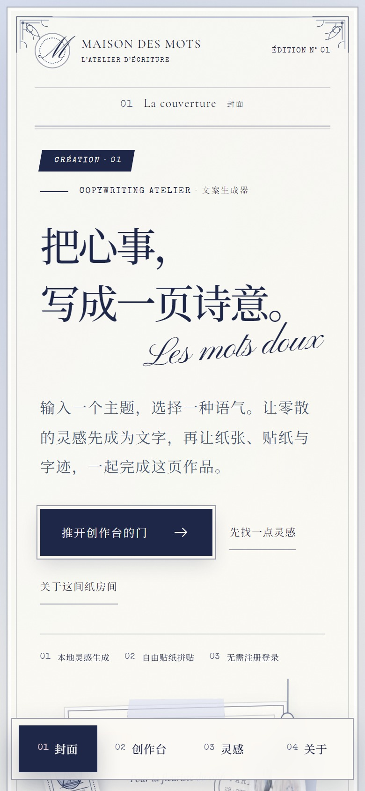

<div align="center">

# Maison des Mots · 字里行间

**把心事，写成一页诗意。**

一间开在浏览器里的法式纸雕文案室。输入一个主题，选一种语气，让文字落在信笺上；
再把香水、玫瑰、旧钥匙与月亮，一枚一枚贴进页边。

[在线参观](https://baxterl.github.io/maison-des-mots/) · [设计 Skill](SKILL.md) · [English](#english)

</div>


## 一页纸的野心

它首先是一个文案生成器：本地模板、三种语气、可直接粘贴的成稿。
但我们更想让它像一件 **可以翻阅的纸上作品**——洛可可的模切白边、银蓝的雾、奶油色的信笺、
挂在丝线上的吊牌，以及那些只有把纸叠起来才会出现的细小阴影。

没有一张背景是图库里的「法式复古」。颜色、字形、纸的厚度、贴纸的轮廓，
都是为了这一页重新定的。

## 美术拆解

**颜色**：奶白 `#FBF9F4` 打底，银蓝 `#DCE2F1 → #BFC8E0` 铺出雾感，雾蓝 `#A9B3CC / #66718F` 做次级信息，
墨蓝 `#1E2748` 收住所有线。藕粉 `#E8C9D0` 只肯露一点点——用于选中态、星芒和一枚蝴蝶结标签。
整页没有暖金，也没有大面积深色；高级感来自留白和一致的 1px 线，而不是堆满装饰。

**字体**：Cormorant Garamond 负责优雅的英文衬线与斜体，Pinyon Script 写那句 `Les mots doux`，
Noto Serif SC 承担中文的呼吸，Special Elite 把档案编号、邮戳和法文小字压成打字机质感。
四种字各司其职，几乎不打架。

**纸的厚度**：没有用任何滤镜贴图。白边 + 细墨蓝描边 + 短距离柔阴影，再叠一层 rotate 与错位，
纸就从平面里站起来了。信笺、吊牌、菱形的 Souvenir 卡、画布上的贴纸，用的都是同一套「模切」语言。

**装饰**：山茶花吊牌来自 Trianon 的 CC0 素材，拱廊版画是 The Met 的公有领域馆藏；
其余六枚贴纸——香水瓶、蓝玫瑰、邮票、旧钥匙、缎带蝴蝶结、月亮挂坠——都是项目里的手绘线稿 SVG，
统一收进墨蓝与银蓝两色，所以再多也不花。


## 它不只是好看

- **三种语气**：温柔诗行 / 法式浪漫 / 俏皮日常，每一个主题都有不同的开头与收束。
- **本地生成**：模板在浏览器里完成，不上传、不登录，写下的心事只留在本地。
- **灵感示例**：花店、月光香水、星期天——点一下就能试写。
- **纸张切换**：奶油纸 / 雾蓝纸，两种底色对应两种心情。
- **自由拼贴**：六类贴纸、最多 8 枚，支持拖拽、方向键微调、Delete 取下，移动端点选后再拖。
- **细节完整**：复制成稿、空主题校验、生成中状态、8 枚上限、读屏播报与 `prefers-reduced-motion` 都有照顾。


## 在手机上

吊牌栏会变成一排纸签，信笺收窄，按钮与贴纸依然留在拇指够得到的地方。



## 运行

```bash
npm install
npm run dev       # 本地开发
npm run build     # 产出 dist/
npm run preview   # 预览构建结果
```

构建部署到 GitHub Pages 时，`VITE_BASE_PATH` 会由 `.github/workflows/deploy.yml` 自动注入为 `/<repo>/`。

## 素材与致谢

- 纸样与山茶花素材：[Trianon](https://github.com/qimingjiu/Trianon)，作者声明为 CC0。
- 拱廊版画：Francesco Guardi，《Architectural Capriccio: Vaulted Colonnade of a Palace》，
  [The Met](https://www.metmuseum.org/art/collection/search/338938)，公有领域。
- 字体：Cormorant Garamond、Pinyon Script、Noto Serif SC、Special Elite，均来自 Google Fonts（SIL OFL）。
  仓库里已做中文用字子集并本地托管（约 200KB），不依赖外部字体 CDN，国内访问也不会掉字体。
- 界面与实现：React 19 + Vite + GSAP（`useGSAP` 入场/视差 + `Draggable` 贴纸拼贴）。

## 把这一页搬走

`SKILL.md` 把整套美术方向和实现路径写成了可复用的 Skill：色板、字体、纸的物理感、
组件配方、动效与可访问性清单，以及最容易踩坏的几个响应式断点。
交给你的 AI 编码助手，就能从一句话开始，重新长出一间自己的纸雕文案室。

## 许可

代码以 [MIT](LICENSE) 发布；图片素材遵循其原始授权（CC0 / 公有领域），请保留上方来源说明。

<a id="english"></a>

## English

**Maison des Mots** ("House of Words") is a rococo paper-collage copywriting atelier in the browser.
Type a topic, pick a tone, receive a letter — then dress the page with die-cut stickers, taped papers,
hanging tags and a souvenir diamond. Built with React 19, Vite and GSAP; the entire art direction is
defined in [SKILL.md](SKILL.md). [Live demo](https://baxterl.github.io/maison-des-mots/).
