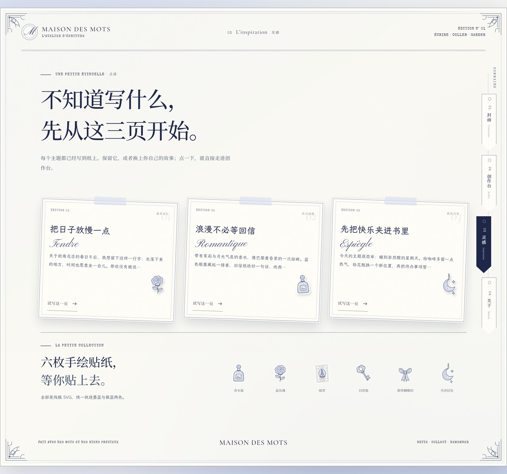

<div align="center">

# Maison des Mots · 字里行间

**把心事，写成一页诗意。**

一间开在浏览器里的法式纸雕文案室。四个章节，像一本可以翻的小书：
右缘是书签，页面会翻过去，笔尖落下，字迹才出现。

[在线参观](https://baxterl.github.io/maison-des-mots/) · [设计 Skill](SKILL.md) · [Skill 仓库](https://github.com/BaxterL/maison-des-mots-skill) · [English](#english)

</div>


## 一本可以翻的小书

页面不再是一条从上滚到底的长卷。封面、创作台、灵感、关于，四页收在同一只书壳里。
右缘挂着四枚书签，每枚都由三层纸叠成——静止时只露出两道纸边，悬停时纸片轻轻抽出，当前页那枚底色变深、层与层散开。中文是主标签，编号退后半步。
翻页时，一张纸从装订边转过去，背面是下一页的章节——不是切换组件，更像把这一页真的翻过去。


## 写自己的，就原样上纸

创作台有两种写法：

- **用灵感起稿**：给一个主题、选一种语气，模板把它补全成一封信。
- **写自己的**：标题可留空，正文原样落到纸上。不追加开头，不追加结尾，连换行都保留。

已经写在纸上的文字，随时可以点「编辑这段」带回编辑区；
书写过程中有「跳过书写」，不想等笔迹一字一字出现时，直接看完整纸面。


## 笔尖落下

正文不是一次性出现的。它按两三个字一组慢慢显影，一支毛笔跟着当前字移动，
写完以后笔收起，只留下纸和字。标题先落，正文后写，最后是签名。
不喜欢等待，可以随时跳过；系统开启「减少动态效果」时，直接呈现完整的纸面。


## 美术拆解

**颜色**：奶白 `#FBF9F4` 打底，银蓝 `#DCE2F1 → #BFC8E0` 铺出雾感，雾蓝 `#B8C2DA / #5C6884` 做次级信息，
墨蓝 `#1E2748` 收住所有线。藕粉 `#E8C9D0` 只肯露一点点——用于选中态、星芒和一枚蝴蝶结标签。
整页没有暖金，也没有大面积深色；高级感来自留白和一致的 1px 线。

**字体**：Cormorant Garamond 负责英文衬线与斜体，Pinyon Script 写那句 `Les mots doux`，
Noto Serif SC 承担中文标题的骨架，Special Elite 把档案编号、邮戳和法文小字压成打字机质感。
信笺正文与灵感卡片换成了 LXGW WenKai（霞鹜文楷），笔画的温度更接近手写的信。
五种字各司其职；全部本地子集，不依赖外部字体 CDN。

**纸的厚度**：没有用任何滤镜贴图。白边 + 细墨蓝描边 + 短距离柔阴影，再叠一层 rotate 与错位，
纸就从平面里站起来了。信笺、吊牌、菱形的 Souvenir 卡、画布上的贴纸，用的都是同一套「模切」语言。

**装饰**：山茶花吊牌与拱廊版画给拼贴一点古典底子；
十枚贴纸——香水瓶、蓝玫瑰、邮票、旧钥匙、缎带蝴蝶结、月亮挂坠、折叠书信、浮雕相框、法式窗扇、植物标本夹——都是手绘线稿 SVG，
统一收进墨蓝与银蓝两色，所以再多也不花。

## 它不只是好看

- **三种语气**：温柔诗行 / 法式浪漫 / 俏皮日常，每一个主题都有不同的开头与收束。
- **自己写**：自定义标题与正文，原样上纸，不做任何模板追加。
- **本地生成**：不上传、不登录，写下的心事只留在这一页。
- **灵感三页**：花店、月光香水、星期天——点一下，直接带着主题走进创作台。
- **纸张切换**：奶油纸 / 雾蓝纸，两种底色对应两种心情。
- **自由拼贴**：十类贴纸、最多 8 枚，支持拖拽、方向键微调、Delete 取下，移动端点选后再拖。
- **信封与墨瓶**：创作台是一只上开信封，信纸装在袋里；右下角的墨瓶与毛笔可以点——蘸一次墨，换一种字迹（文楷 / 宋体 / 拉丁）。
- **细节完整**：复制成稿、复制印章、空主题校验、书写跳过、8 枚上限、读屏播报与 `prefers-reduced-motion` 都有照顾。

## 灵感页

三个示例不是列表项，而是三张已经写好的纸。悬停时纸页轻轻抬起，点「试写这一页」就带着主题去创作台。
下面是一只小小的贴纸样本册，十枚线稿排成两行。



## 在手机上

右缘书签变成固定在底部的纸质 tab 条，仍保留三道纸边的层叠语言；封面收起吊牌栏，让标题和主按钮更早出现；
创作台保持单列，先输入，再看到纸。


## 运行

```bash
npm install
npm run dev       # 本地开发
npm run build     # 产出 dist/
npm run preview   # 预览构建结果
```

构建部署到 GitHub Pages 时，`VITE_BASE_PATH` 会由 `.github/workflows/deploy.yml` 自动注入为 `/<repo>/`。

技术：React 19 + Vite + GSAP（`useGSAP` 页面入场/笔写作、`Draggable` 贴纸拼贴）。
字体全部做了中文子集并本地托管，不依赖外部字体 CDN。

## 把这一页搬走

`SKILL.md` 把整套美术方向、翻页与笔写作的实现路径写成了可复用的 Skill：
色板、字体、纸的物理感、组件配方、动效、可访问性清单，以及最容易踩坏的几个响应式断点。
交给你的 AI 编码助手，就能从一句话开始，重新长出一间自己的纸雕文案室。

也可以直接从 [maison-des-mots-skill](https://github.com/BaxterL/maison-des-mots-skill) 取用。

## 许可

代码以 [MIT](LICENSE) 发布。

<a id="english"></a>

## English

**Maison des Mots** ("House of Words") is a rococo paper-collage copywriting atelier in the browser.
Four chapters live inside a single book shell: a cover, an atelier, an inspiration page and a maison page.
A ribbon bookmark menu sits on the right edge, the screen turns like a sheet of paper, and a quill writes
the letter one phrase at a time. Write with a prompt, or bring your own text — yours lands on the paper
exactly as typed. Built with React 19, Vite and GSAP; the art direction lives in [SKILL.md](SKILL.md).
[Live demo](https://baxterl.github.io/maison-des-mots/).
